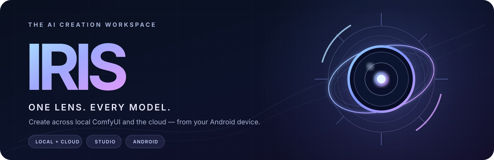
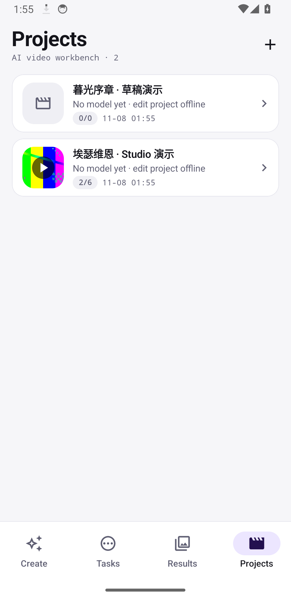
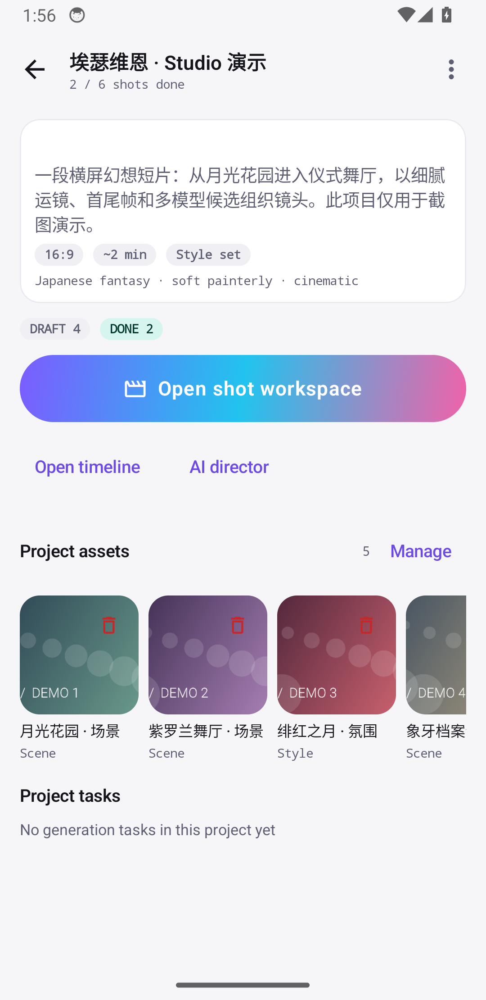
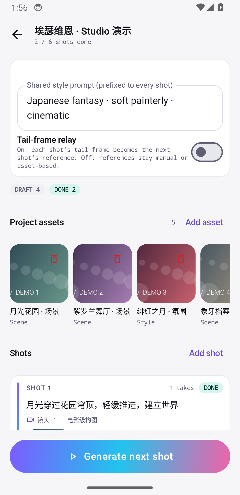
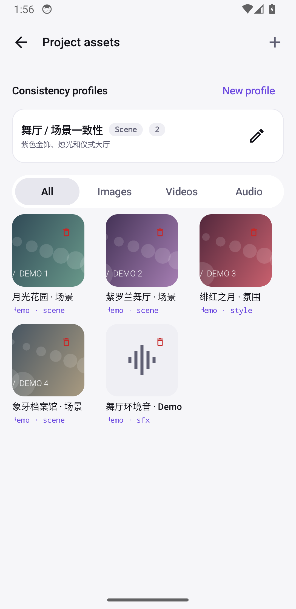
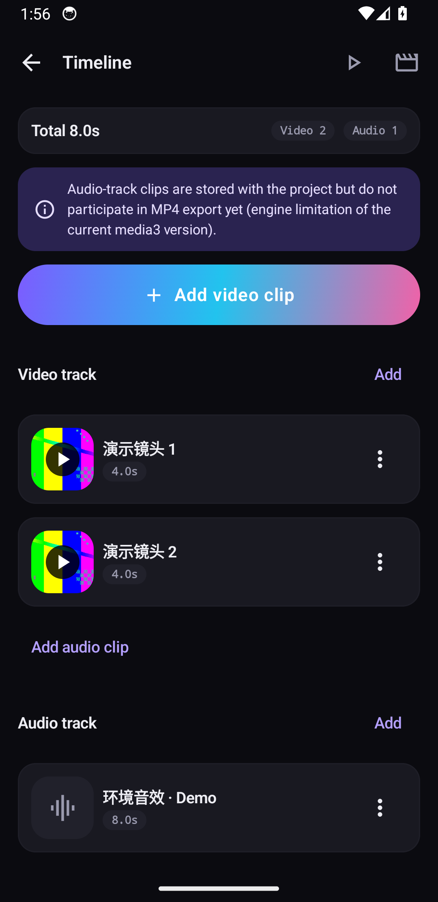
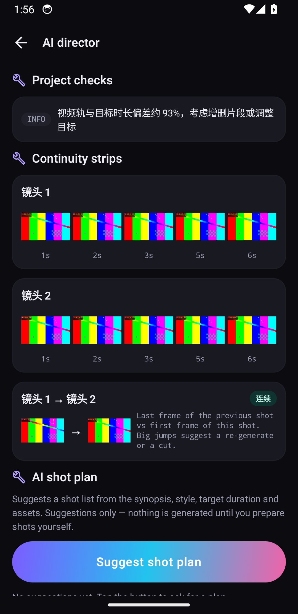
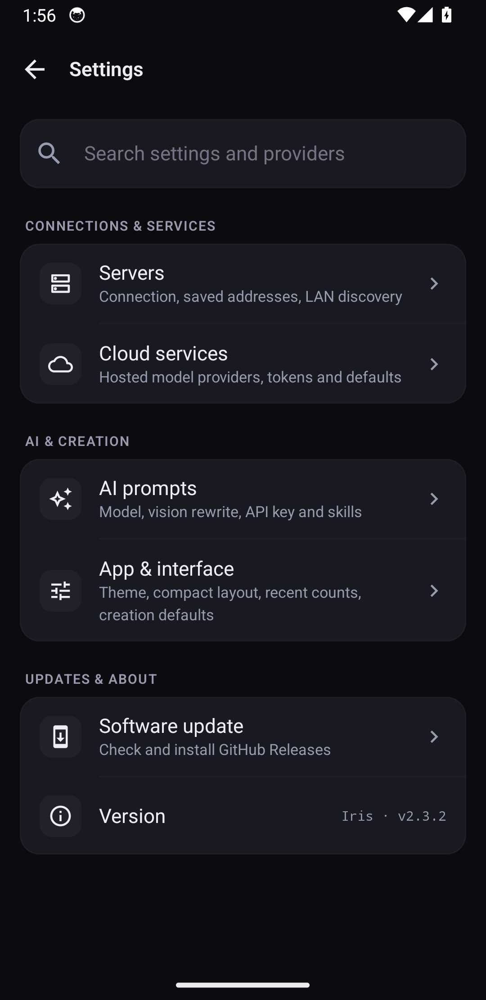
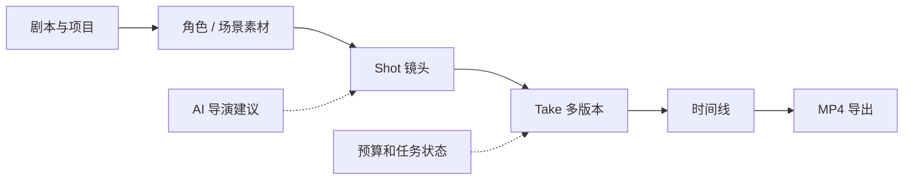

<div align="center">



# Iris · 灵瞳

**让 AI 创作回到一个工作台。** 连接本地 ComfyUI 与多家云端模型，在 Android 上完成从提示词、素材、镜头到结果的创作流程。

**One lens. Every model.** Local ComfyUI and cloud AI creation, thoughtfully brought together on Android.

[](https://github.com/Starysoor/Iris/releases/latest)
[](https://github.com/Starysoor/Iris/actions/workflows/test.yml)
[](#快速开始--quick-start)
[](LICENSE)

**[⬇ 获取正式版 APK](https://github.com/Starysoor/Iris/releases/latest)** · **[🧪 beta.2 真机测试版](https://github.com/Starysoor/Iris/releases/tag/v2.4.0-beta.2)** · **[查看新界面](#真实界面--live-screens)** · **[Studio 开发计划](https://github.com/Starysoor/Iris/issues/57)** · **[使用指南](#文档导航--documentation)**

[简体中文](#中文介绍) · [English](#english-overview)

</div>

> [!IMPORTANT]
> **版本说明 / Release status:** GitHub Releases 的稳定版仍为 **v2.3.2**；新版 **[v2.4.0-beta.2 测试版](https://github.com/Starysoor/Iris/releases/tag/v2.4.0-beta.2)** 已签名发布（`versionCode 30`），包含 Studio 跨页联动、手动阶段配方、精确模型字段绑定和结构化 AI 导演等功能。PR #91 的独立音轨混音已合并；**完整 120 秒真机短片及跨厂商自动执行尚未完成验收**，分别见 [#80](https://github.com/Starysoor/Iris/issues/80) / [#101](https://github.com/Starysoor/Iris/issues/101)，不可将 beta.2 视为正式版。下方截图为真实 Android 模拟器的离线演示数据，非付费生成证明。

## 真实界面 · Live screens

<p align="center"><sub>真实 Android 14 模拟器截图 / Actual Compose UI · Offline demo project · No paid generation</sub></p>

<table>
<tr>
<td align="center" width="33%"><a href="docs/verification/showcase-2026/01-projects-light.png"></a><br><b>项目中心 · Projects</b></td>
<td align="center" width="33%"><a href="docs/verification/showcase-2026/02-overview-light.png"></a><br><b>创作概览 · Overview</b></td>
<td align="center" width="33%"><a href="docs/verification/showcase-2026/03-shots-light.png"></a><br><b>镜头工坊 · Shots</b></td>
</tr>
<tr>
<td align="center"><a href="docs/verification/showcase-2026/04-assets-light.png"></a><br><b>素材档案 · Assets</b></td>
<td align="center"><a href="docs/verification/showcase-2026/05-timeline-dark.png"></a><br><b>剪辑时间线 · Timeline</b></td>
<td align="center"><a href="docs/verification/showcase-2026/06-director-dark.png"></a><br><b>AI 导演 · Director</b></td>
</tr>
</table>

<details><summary><b>更多截图 / More screenshots</b></summary>

<a href="docs/verification/showcase-2026/07-settings-dark.png"></a>

截图采集脚本：[`tools/qa_capture_showcase.sh`](tools/qa_capture_showcase.sh)。旧版真实截图仍保留在 [历史验证资料](docs/verification/) 中。

</details>

---

## 中文介绍

### 一个入口，贯穿创作流程

| | 工作环节 | 主要能力 |
|:--|:--|:--|
| **01 · 连接** | 本地和云端 | ComfyUI、多服务器、Tailscale、AutoDL 和云端 Provider |
| **02 · 创作** | 多模态任务 | 生图、视频、音频、首尾帧、多图参考和批量队列 |
| **03 · 组织** | 项目与版本 | Studio、角色/场景档案、Shot / Take 多版本（开发中） |
| **04 · 输出** | 结果和成片 | 结果库、复用、分享、时间线和 MP4（开发中） |

### 为什么选择 Iris？

- **模型不再分散。** 同一客户端可配置本地 ComfyUI、AutoDL.Art、OpenAI、Gemini、Replicate、SiliconFlow、AutoDL Models 及兼容 API；具体模型与能力取决于服务商接口和验证范围。
- **参考图有明确语义。** 根据真实模型输入契约映射多图、首帧/尾帧、提示词、种子、参数与高级字段；支持 ComfyUI 工作流 API 格式转换。
- **任务与结果持续可用。** 前台任务、节点进度、本地队列、重启恢复、媒体缩略图和播放、A/B 对比、再次使用、云端结果及时下载。
- **付费调用有确认。** 展示可获取的价格和预估成本，提供付费提交确认和本地预算闸门；估算值不能取代厂商账单。
- **Studio 朝完整短片工作台演进。** 项目、素材、镜头多版本、时间线、衔接检查和 AI 导演；AI 只提建议，不会自行提交付费作业。

### Iris Studio · 下一阶段



**开发说明：** `main` 已包含 Studio 素材/项目/任务联动与音轨混合导出等代码，并通过相应自动化回归。最新已签名 [beta.2](https://github.com/Starysoor/Iris/releases/tag/v2.4.0-beta.2) 可供真机试用；完整 120 秒成片、实体设备更多机型和跨厂商自动编排仍需通过 [#80](https://github.com/Starysoor/Iris/issues/80) / [#101](https://github.com/Starysoor/Iris/issues/101) 的独立验收。

## 快速开始 · Quick start

1. 从 [Releases](https://github.com/Starysoor/Iris/releases/latest) 下载稳定版 APK，或从 [beta.2 预发布页](https://github.com/Starysoor/Iris/releases/tag/v2.4.0-beta.2) 获取最新真机测试包。测试版安装前请备份数据。为兼容原有升级路径，应用包名仍为 `com.comfyremote.app`。
2. **云端模式：** 在「设置 → 云服务」配置各 Provider 凭据；**本地模式：** 启动监听 `0.0.0.0:8188` 的 ComfyUI，使用局域网地址或已授权的 Tailscale 地址连接。
3. 选择模型/工作流并编辑提示词与参考图，确认参数和费用提示，提交后在任务和结果页追踪输出。

| 连接方式 | 地址或入口 |
|:--|:--|
| Android 模拟器 → 宿主电脑 | `http://10.0.2.2:8188` |
| 手机与电脑同 Wi-Fi | `http://<PC_LAN_IP>:8188` |
| 远程 Tailscale | 设备 IP / MagicDNS（需要 ACL 与服务可达） |
| 多厂商云端 | 「设置 → 云服务」，独立配置 Provider |

> [!CAUTION]
> **费用与数据安全：** 取消本地跟踪并不保证取消远端付费作业。远端结果链接可能过期，请及时保存。远端已接受但本地保存失败时，应先确认厂商状态再重试。少数 Android 设备在 Keystore 不可用时可能使用明文凭据回退，不建议在不可信设备保存敏感 API Key。

## 文档导航 · Documentation

| 内容 | 入口 |
|:--|:--|
| 云端平台、恢复与限制 | [Cloud Providers](docs/CloudProviders.md) |
| AutoDL 托管工作流 | [AutoDL guide](docs/AutoDL.md) |
| Tailscale 与本地服务器 | [Tailscale discovery](docs/TAILSCALE_DISCOVERY.md) |
| Studio 结构、迁移和回滚 | [Project model](docs/PROJECT_MODEL.md) |
| Studio 测试与真机验收 | [Studio QA](docs/STUDIO_QA.md) |
| 历史更新与版本下载 | [CHANGELOG](CHANGELOG.md) · [Releases](https://github.com/Starysoor/Iris/releases) |
| 报错或需求建议 | [Issues](https://github.com/Starysoor/Iris/issues) |

<details><summary><b>开发构建 / Build from source</b></summary>

需要 JDK 17、Android SDK（compileSdk 34）及 Gradle 8.7：

```bash
./gradlew :app:assembleDebug
./gradlew :app:testDebugUnitTest
./gradlew :app:lintDebug
```

Windows PowerShell 改用 `.\gradlew.bat`。发布由版本标签触发 GitHub Actions 的签名构建流程；Debug / Release 候选不等于正式签名 APK。

</details>

---

## English overview

**Iris** is a native Android companion for local ComfyUI workflows and hosted AI providers. Choose a provider, bring reference images, inspect model inputs, confirm paid submissions, then keep your tasks and media results organized.

**Core capabilities:** multi-server ComfyUI; configurable cloud and OpenAI-compatible providers; image/video/audio workflows; first/last-frame and multi-image inputs; AI prompt skills; task progress and recovery; result playback and reuse. The project-driven **Iris Studio** is under active development.

**Release clarity:** stable APK **v2.3.2**; signed [v2.4.0-beta.2 prerelease](https://github.com/Starysoor/Iris/releases/tag/v2.4.0-beta.2) is available for device testing. Cross-page project links, manual model recipes, verified media-field mapping, and grounded AI director plans are included, but automatic cross-provider orchestration and the full 120-second real-device film are not yet verified. Screens above are genuine Android emulator captures with labeled offline demo fixtures. Follow [#80](https://github.com/Starysoor/Iris/issues/80) and [#101](https://github.com/Starysoor/Iris/issues/101) for remaining acceptance.

Learn more: [Cloud services](docs/CloudProviders.md) · [AutoDL](docs/AutoDL.md) · [Studio model](docs/PROJECT_MODEL.md) · [Latest release](https://github.com/Starysoor/Iris/releases/latest).

---

<div align="center">

**Iris · 灵瞳** · Designed for creators who work across models.

[Report a bug](https://github.com/Starysoor/Iris/issues/new) · [Release notes](CHANGELOG.md) · [MIT License](LICENSE)

</div>
